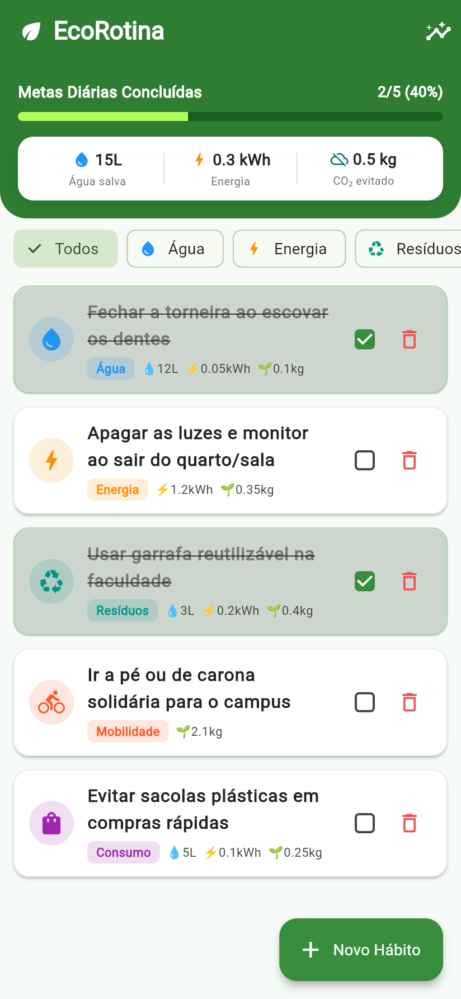
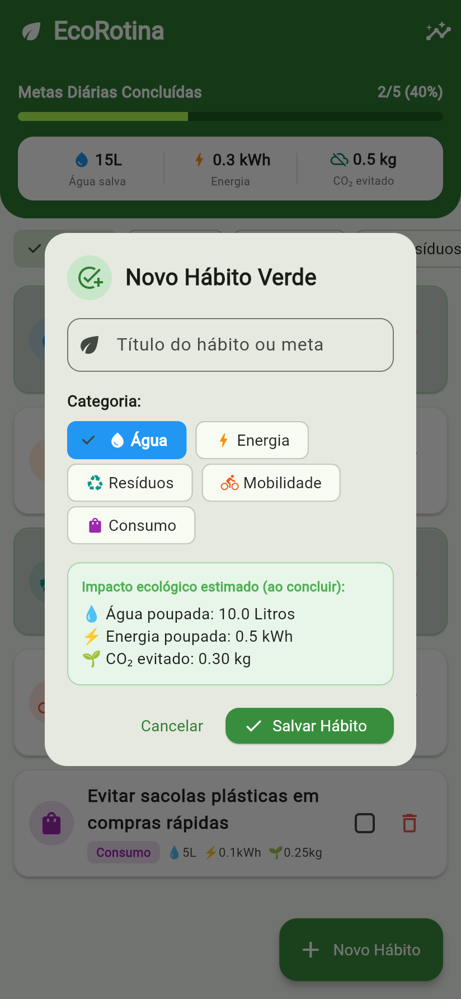
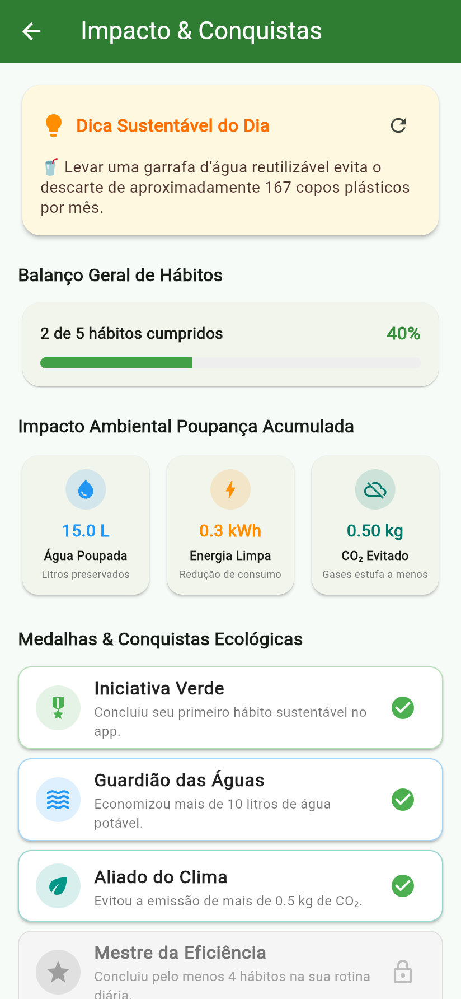

# EcoRotina 🌱 — Aplicativo de Sustentabilidade

> **Atividade OAT — Desenvolvimento Mobile Híbrido (Flutter)**  
> **Faculdade UniFTC** | **Professor:** XZ6816 (`XZ6816@prof.uniftc.edu.br`)  
> **Trabalho em Dupla:** Valor 20 Pontos (10 APK + 10 Documentação)

---

## 📱 Sobre o EcoRotina
O **EcoRotina** é um aplicativo mobile híbrido desenvolvido em **Flutter** focado em resolver um dos maiores desafios do nosso tempo: a sustentabilidade no cotidiano. O app transforma pequenos hábitos diários em impactos ambientais positivos e mensuráveis, alinhando-se aos **Objetivos de Desenvolvimento Sustentável (ODS) 12 e 13 da ONU**.

### 🌟 Principais Funcionalidades & Requisitos Atendidos
- **Lista Interativa de Metas/Hábitos:** Categorizados por *Água, Energia, Resíduos, Mobilidade e Consumo*.
- **Ações na Lista:** Adicionar novos hábitos (via Modal Dialog), Concluir (checkbox dinâmico com efeito visual) e Remover (botão de lixeira com confirmação).
- **Persistência de Dados:** Salva e carrega automaticamente no disco do celular usando `shared_preferences` com serialização e desserialização em JSON.
- **Segunda Tela com Navegação:** Tela de estatísticas detalhadas acessível pelo AppBar via `Navigator.push`.
- **Diferenciais Criativos:**
  - 💧 **Calculadora de Impacto em Tempo Real:** Litros de água poupados, kWh de energia economizados e kg de CO₂ evitados calculados instantaneamente.
  - 📈 **Progresso Diário:** Barra de acompanhamento percentual das metas do dia.
  - 💡 **Dica Sustentável do Dia:** Dicas práticas e rotativas para aplicar em casa ou na universidade.
  - 🏅 **Medalhas Virtuais (Gamificação):** Conquistas desbloqueadas conforme o cumprimento dos hábitos.

---

## 📸 Capturas de Tela (Evidências)

| Tela Principal (Impacto & Metas) | Adicionar Hábito (Modal) | Conclusão & Recálculo |
| :---: | :---: | :---: |
|  |  |  |

| Segunda Tela (Dica & Resumo) | Conquistas & ODS da ONU |
| :---: | :---: |
|  |  |

---

## 📦 Como Instalar o APK no Celular Android

O arquivo executável do aplicativo já está compilado e disponível na pasta:
👉 **[`release/apk/ecorotina.apk`](release/apk/ecorotina.apk)** *(ou em `build/app/outputs/flutter-apk/app-release.apk`)*

1. Transfira o arquivo `ecorotina.apk` para o celular (via cabo USB, Drive, WhatsApp, etc.).
2. No celular, clique sobre o arquivo `.apk` baixado.
3. Se solicitado, permita a instalação a partir da fonte desconhecida.
4. Clique em **Instalar** e, ao finalizar, em **Abrir**.

---

## 🛠️ Como Executar o Projeto Localmente

### Pré-requisitos
- Flutter SDK instalado (versão 3.24 ou superior)
- Android SDK configurado

### Comandos Flutter
```bash
# Obter as dependências do pub
flutter pub get

# Executar a suíte de testes unitários e de widgets
flutter test

# Executar o aplicativo no emulador ou dispositivo conectado
flutter run

# Compilar novo arquivo APK de produção (Release)
flutter build apk
```

---

## 📱 Como Rodar no Celular Físico como Dev Flutter

Você pode executar o app diretamente no seu celular com suporte completo a **Hot Reload** (alterar o código e ver na hora):

### Passo 1: Ativar o Modo Desenvolvedor no Celular Android
1. No seu celular, vá em **Configurações** > **Sobre o telefone**.
2. Toque **7 vezes seguidas** em **"Número da versão"** (ou *Versão da Build*) até aparecer *"Você agora é um desenvolvedor"*.
3. Volte e entre no novo menu **Opções do desenvolvedor** (ou *Configurações adicionais* > *Opções do desenvolvedor*).
4. Ative a opção **Depuração USB**.

---

### Passo 2: Executar no Celular (Via Cabo USB - Mais Rápido)
1. Conecte o celular ao computador via cabo USB.
2. Na tela do celular, quando perguntar *"Permitir depuração USB?"*, marque **Sempre permitir** e toque em **Permitir**.
3. No terminal do computador, verifique se o celular foi reconhecido:
   ```bash
   flutter devices
   ```
   *(O nome/modelo do seu celular deve aparecer na lista)*
4. Execute o app:
   ```bash
   flutter run
   ```
5. O Flutter vai compilar e instalar o app direto no celular em modo de desenvolvimento! Pressionando `r` no terminal você aciona o **Hot Reload**.

---

### Passo Alternativo: Sem Fio (Depuração Wi-Fi no Android 11+)
1. No celular (conectado na mesma rede Wi-Fi do PC), vá em **Opções do desenvolvedor** > **Depuração sem fio** e ative-a.
2. Toque em **"Emparelhar dispositivo com código de pareamento"** (mostrará o IP, porta e código de 6 dígitos).
3. No terminal do PC, rode:
   ```bash
   adb pair <IP>:<PORTA_DO_PAREAMENTO>
   ```
   *(Digite o código de 6 dígitos quando solicitado)*
4. Em seguida, conecte:
   ```bash
   adb connect <IP>:<PORTA_PRINCIPAL>
   ```
5. Agora rode `flutter run` normalmente!

---

## 📄 Documentação Completa para Entrega
O documento oficial de entrega exigido na atividade está gerado em PDF:
- **PDF Oficial:** [`doc/DOCUMENTACAO_ECO_ROTINA.pdf`](doc/DOCUMENTACAO_ECO_ROTINA.pdf)
- **Versão Markdown:** [`doc/DOCUMENTACAO.md`](doc/DOCUMENTACAO.md)
- **Versão HTML:** [`doc/documentacao.html`](doc/documentacao.html)

---

## 👥 Integrantes da Dupla
- **Marco** (Preencher com Nome Completo e Matrícula)
- **(Integrante 2)** (Preencher com Nome Completo e Matrícula da Dupla)
