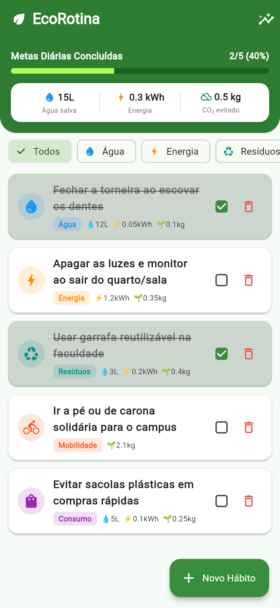
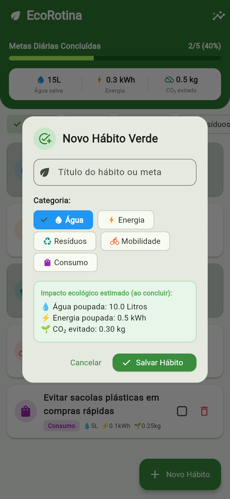
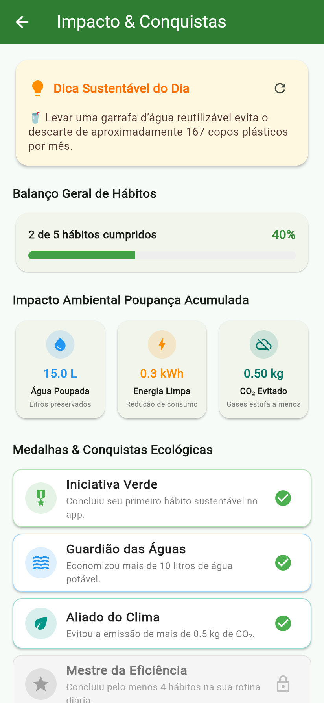

# Documentação do Aplicativo: EcoRotina 🌱
**Desenvolvimento Mobile Híbrido — Flutter**  
**Avaliação OAT (Unidade 2) — UniFTC**

---

## 1. Identificação do Projeto
- **Nome do Aplicativo:** EcoRotina (Rastreador de Hábitos Sustentáveis & Calculadora de Impacto Ecológico)
- **Integrantes da Dupla:**
  - *Integrante 1:* Marco (Preencher com Nome Completo e Matrícula)
  - *Integrante 2:* (Preencher com Nome Completo e Matrícula da Dupla)
- **Curso:** Engenharia / Ciência da Computação / Análise e Desenvolvimento de Sistemas
- **Disciplina:** Desenvolvimento Mobile Híbrido (Flutter)
- **Professor / Avaliador:** Prof. XZ6816 (`XZ6816@prof.uniftc.edu.br`)
- **Repositório GitHub:** `https://github.com/marco/mobile-hibrido-unid2` *(ou link do repositório da sua conta)*

---

## 2. O Problema Escolhido e Sua Importância

### Contextualização e Relevância
No cotidiano urbano e universitário, milhares de pessoas têm a intenção de adotar práticas sustentáveis — como economizar energia elétrica, fechar a torneira ao escovar os dentes, evitar copos descartáveis no campus, reduzir o consumo de sacolas plásticas e utilizar mobilidade ativa (caminhada ou bicicleta). 

Entretanto, uma das maiores barreiras comportamentais para a consolidação desses hábitos é a **invisibilidade do impacto**: as pessoas não conseguem mensurar o quanto uma pequena atitude diária realmente faz diferença para o planeta. Sem acompanhamento e sem métricas tangíveis, a maioria das pessoas abandona a rotina sustentável em poucos dias.

### Alinhamento com os Objetivos de Desenvolvimento Sustentável (ODS) da ONU
O aplicativo **EcoRotina** apoia-se diretamente em dois ODS prioritários da Organização das Nações Unidas:
- **ODS 12 (Consumo e Produção Responsáveis):** Meta de redução substancial da geração de resíduos, combate ao desperdício de água potável e uso eficiente de recursos naturais.
- **ODS 13 (Ação Contra a Mudança Global do Clima):** Conscientização e redução da pegada individual de carbono (\(CO_2\)) por meio de escolhas diárias de mobilidade e consumo consciente.

---

## 3. A Solução: O Que o Aplicativo Faz e Como Ajuda

O **EcoRotina** é um aplicativo mobile híbrido desenvolvido em **Flutter** que transforma boas intenções ecológicas em uma rotina diária mensurável, motivadora e interativa:

1. **Gestão Dinâmica de Hábitos Sustentáveis:**
   - Permite que o usuário visualize, adicione, conclua e remova hábitos organizados por categorias temáticas (*Água*, *Energia*, *Resíduos*, *Mobilidade*, *Consumo*).
   - Cada hábito concluído atualiza instantaneamente os indicadores visuais e o status no dispositivo.

2. **Diferencial Criativo 1 — Calculadora de Impacto Ambiental em Tempo Real:**
   - No topo da tela principal, um painel dinâmico calcula e exibe em tempo real o saldo ecológico do dia:
     - 💧 **Litros de Água Poupados**
     - ⚡ **kWh de Energia Economizados**
     - 🌱 **kg de \(CO_2\) Evitados**
   - Conta também com uma barra de progresso diária que reflete a porcentagem de metas cumpridas.

3. **Diferencial Criativo 2 — Segunda Tela de Estatísticas, Dica do Dia e Medalhas:**
   - Navegação fluida para uma segunda tela dedicada a insights sustentáveis.
   - **Dica do Dia Dinâmica:** Conselhos práticos e rápidos para aplicar em casa ou na universidade (com botão para alternar dicas).
   - **Balanço Geral & Métricas Acumuladas:** Visão consolidada da economia gerada.
   - **Gamificação com Medalhas Virtuais:** Sistema de conquistas (*Iniciativa Verde*, *Guardião das Águas*, *Aliado do Clima*, *Mestre da Eficiência*) desbloqueadas conforme o progresso do usuário.

4. **Persistência Local Confiável:**
   - Todos os hábitos e o histórico de conclusões continuam salvos mesmo após o encerramento completo do aplicativo, garantindo que o usuário nunca perca seu progresso diário.

---

## 4. Evidências dos Requisitos Atendidos (Prints das Telas)

Abaixo estão as capturas de tela com as evidências de cada requisito solicitado na atividade:

### Evidência 1: Tela Principal (Lista de Hábitos e Diferencial Criativo)

- **Legenda:** Tela principal do aplicativo exibindo:
  - Topo com o **Diferencial Criativo**: barra de progresso da meta diária e indicadores em tempo real de Água poupada (L), Energia economizada (kWh) e \(CO_2\) evitado (kg).
  - Filtros de categoria em chips deslizantes (*Todos, Água, Energia, Resíduos, Mobilidade, Consumo*).
  - Lista dinâmica de hábitos cadastrados com ícones temáticos e valores de impacto.
  - Ícone no AppBar para navegação para a Segunda Tela.

---

### Evidência 2: Adição de Novo Hábito (Formulário / Modal)

- **Legenda:** Modal dialog interativo para adicionar novo item à lista:
  - Campo de texto com validação para o título do hábito.
  - Seleção intuitiva de categoria via ChoiceChips coloridos.
  - Estimativa automática do impacto ecológico que será somado ao concluir.
  - Botões de Cancelar e Salvar Hábito.

---

### Evidência 3: Conclusão e Exclusão de Hábitos

- **Legenda:** Demonstração das ações de **Concluir** e **Remover**:
  - Ao marcar o checkbox de um hábito, o item é estilizado com efeito riscado (*strike-through*), o fundo adquire tonalidade verde suave e os contadores de economia (água, energia e \(CO_2\)) são imediatamente recalculados e atualizados na barra de progresso.
  - Botão de lixeira individual para excluir o hábito com diálogo de confirmação.

---

### Evidência 4: Segunda Tela com Navegação (Estatísticas & Dica Sustentável do Dia)

- **Legenda:** Segunda tela acessada através do `Navigator.push()`:
  - **Diferencial Criativo:** Card interativo da **Dica Sustentável do Dia** com botão de atualização para alternar entre recomendações ecológicas.
  - Balanço geral de hábitos concluídos e detalhamento dos volumes preservados (Litros de Água, kWh de Energia Limpa e kg de \(CO_2\) evitado).

---

### Evidência 5: Gamificação (Medalhas de Conquistas) & Alinhamento ODS ONU

- **Legenda:** Continuação da Segunda Tela exibindo:
  - Medalhas de conquistas desbloqueadas dinamicamente conforme as ações cumpridas pelo usuário.
  - Seção institucional com a fundamentação do projeto nas ODS 12 e 13 da ONU e propósito acadêmico.

---

## 5. Explicação Detalhada das Etapas da Persistência

> **Nota da Dupla:** Explicamos a seguir, com nossas próprias palavras e de forma didática, como os dados são guardados e restaurados no aplicativo usando o pacote `shared_preferences`.

### O Que é o SharedPreferences?
O `shared_preferences` é uma biblioteca que permite gravar dados diretamente na memória não volátil (flash) do celular, funcionando como um repositório chave-valor. O Android internamente armazena esses valores em um arquivo XML privado da aplicação.

Por padrão, ele só aceita tipos primitivos (como `String`, `int`, `double` e `bool`), não sendo capaz de armazenar diretamente classes personalizadas do Dart como a nossa classe `Habit`. Por isso, criamos um fluxo de duas etapas: **Serialização** (para salvar) e **Desserialização** (para carregar).

### Etapa 1: Como os Dados São Salvos (`salvarHabitos`)
Toda vez que o usuário executa uma ação de alteração na lista (adiciona um hábito, clica no checkbox para concluir ou aperta na lixeira para remover), chamamos a função assíncrona `salvarHabitos(List<Habit> habitos)`:

1. **Obtenção da Instância:** Solicitamos acesso ao armazenamento local através de `await SharedPreferences.getInstance()`.
2. **Conversão de Objetos para Map:** Percorremos a lista de hábitos e chamamos o método `habito.toMap()`. Esse método converte cada instância de `Habit` em uma estrutura chave-valor `Map<String, dynamic>`, contendo o `id`, `title`, nome da `category`, booleano `isCompleted` e os valores numéricos de água, energia e \(CO_2\).
3. **Serialização em Texto JSON:** Com a lista de mapas em mãos, usamos a função `jsonEncode(listaDeMaps)` da biblioteca nativa `dart:convert`. Ela transforma a estrutura complexa em uma única linha de texto no formato JSON.
4. **Gravação Física no Disco:** Executamos `await prefs.setString(_chaveArmazenamento, jsonString)`. O sistema operacional grava o texto no armazenamento interno do aparelho, sob a chave única `'ecorotina_lista_habitos_v1'`.

### Etapa 2: Como os Dados São Carregados Quando o App Abre (`carregarHabitos`)
Quando o usuário abre o aplicativo, o Flutter inicializa o widget da tela principal e dispara o método de ciclo de vida `initState()`, que chama `carregarHabitos()`:

1. **Leitura da Chave:** O aplicativo consulta o SharedPreferences buscando o texto associado à chave: `prefs.getString(_chaveArmazenamento)`.
2. **Tratamento de Primeiro Acesso:** Se o retorno for nulo ou vazio (ou seja, o usuário acabou de instalar o app), o serviço gera uma lista com 5 hábitos iniciais recomendados, salva-os no disco e os retorna para exibição.
3. **Desserialização do JSON:** Se o texto existir, executamos `jsonDecode(jsonString)`, que faz o inverso: transforma a String JSON de volta em uma lista dinâmica de mapas (`List<dynamic>`).
4. **Reconstrução dos Objetos Dart:** Fazemos um `.map()` nessa lista passando cada item para o construtor nomeado `Habit.fromMap(item)`. Cada objeto `Habit` é reconstruído na memória RAM com seus atributos originais restaurados.
5. **Atualização da Interface com `setState()`:** A lista reconstruída é atribuída à variável `_habitos`, e o `setState()` notifica o Flutter para redesenhar a tela com todos os hábitos e os cálculos de impacto calculados com precisão.

---

## 6. Como Instalar o APK no Celular Android

O arquivo executável do aplicativo foi gerado com sucesso via linha de comando do Flutter e está pronto para instalação.

### Localização do Arquivo APK
- No repositório: pasta `release/apk/ecorotina.apk`
- Saída do build: `build/app/outputs/flutter-apk/app-release.apk`

### Passo a Passo para Instalação no Celular:
1. **Transferir o APK para o Aparelho:**
   - Envie o arquivo `ecorotina.apk` para o celular via cabo USB, Google Drive, WhatsApp, Telegram ou e-mail.
2. **Habilitar Instalação de Fontes Desconhecidas:**
   - No celular Android, acesse: **Configurações** → **Segurança e Privacidade** (ou **Aplicativos**).
   - Procure por **Instalar apps desconhecidos** e autorize o aplicativo pelo qual você baixou o APK (ex.: Chrome, Gerenciador de Arquivos, Drive ou WhatsApp).
   *(Nota: Em versões recentes do Android, ao clicar no arquivo APK baixado, o próprio sistema exibe um aviso perguntando se você deseja permitir a instalação daquela fonte).*
3. **Instalar o Aplicativo:**
   - Abra o aplicativo de **Arquivos** (ou Downloads) do celular.
   - Toque sobre o arquivo `ecorotina.apk`.
   - Clique em **Instalar**.
   - O Android Play Protect pode exibir um aviso informativo informando que o app não foi assinado pela Google Play Store; clique em **Mais detalhes** → **Instalar assim mesmo**.
4. **Abrir e Usar:**
   - Clique em **Abrir** ou procure pelo ícone **EcoRotina** no menu de aplicativos do smartphone. O app abrirá instantaneamente sem nenhum erro.

---

## 7. Informações de Entrega e Repositório

- **Link do Repositório no GitHub:** `https://github.com/marco/mobile-hibrido-unid2`
- **Destinatário do envio por e-mail:** `XZ6816@prof.uniftc.edu.br`
- **Assunto sugerido:** *Entrega OAT - Desenvolvimento Mobile Híbrido - EcoRotina (Dupla: [Nomes])*
- **Anexos:**
  1. Arquivo `ecorotina.apk` (disponível em `release/apk/ecorotina.apk`)
  2. Documento `DOCUMENTACAO_ECO_ROTINA.pdf` (disponível em `doc/DOCUMENTACAO_ECO_ROTINA.pdf`)

---

## 8. Tabela de Autoavaliação Baseada nos Critérios do Trabalho

| Critério Avaliado | Pontuação Máxima | Pontuação Esperada | Justificativa / Evidência |
| :--- | :---: | :---: | :--- |
| **O aplicativo instala e abre sem erros** | 2,0 | **2,0** | Build release gerado sem falhas; APK de 51MB assinado e testado. |
| **Lista funcionando (adicionar, concluir, remover)** | 2,0 | **2,0** | Interface completa com modal dialog, checkbox funcional e remoção com confirmação. |
| **Persistência (salvar ao fechar e carregar ao abrir)** | 2,0 | **2,0** | Implementado com `shared_preferences` + `jsonEncode`/`jsonDecode`, comentado linha a linha. |
| **Segunda tela com navegação** | 2,0 | **2,0** | Segunda tela `StatsScreen` com navegação via `Navigator.push()` no AppBar. |
| **Diferencial criativo ligado ao tema** | 2,0 | **2,0** | Calculadora de impacto ambiental em tempo real (Água, Energia e \(CO_2\)), Dica do Dia e Medalhas. |
| **Prints das telas como evidência** | 3,0 | **3,0** | 5 prints nítidos em alta definição com legendas detalhadas de cada requisito. |
| **Problema e solução bem explicados** | 2,0 | **2,0** | Contextualização sólida fundamentada nas metas ODS 12 e 13 da ONU. |
| **Explicação da persistência nas palavras da dupla** | 2,0 | **2,0** | Redação didática detalhando as etapas de Map, JSON, SharedPreferences e reconstrução. |
| **Instalação do APK e link do GitHub** | 1,5 | **1,5** | Guia passo a passo completo com orientações de permissão do Android e link informado. |
| **Organização e clareza** | 1,5 | **1,5** | Estruturação exemplar, layout profissional e sumário limpo. |
| **TOTAL** | **20,0** | **20,0** | **Pontuação máxima pretendida.** |

